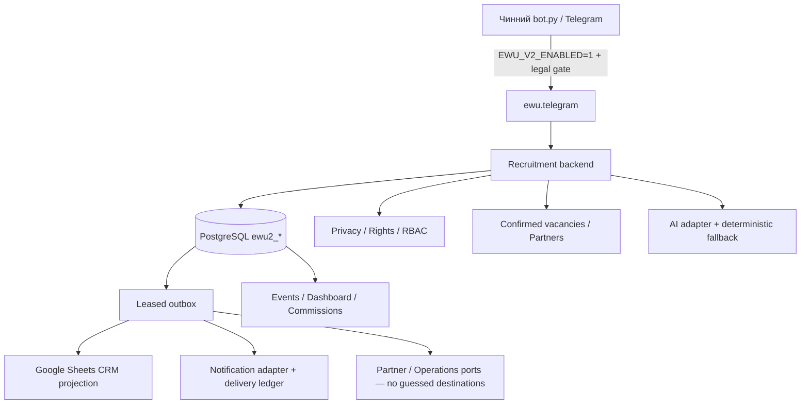

# EWU v2 — архітектура та межі готовності

Статус: перевірене офлайн-ядро за feature flag, не production deployment. Базовий аудит — [EWU_AUDIT.md](EWU_AUDIT.md). PostgreSQL є запропонованим canonical store, доки аудит живої БД/GreenWork не підтвердить сумісність. Жодну робочу БД не обрано або мігровано автоматично.

## Компоненти

- `ewu/storage.py`: DB-API PostgreSQL adapter (psycopg) і окрема SQLite in-memory фабрика синтетичних тестів. Production factory не використовує SQLite і не застосовує міграції.
- `ewu/service.py`, `domain.py`: транзакційні сутності, RBAC/partner scope, права, profile/application lifecycle, підтвердження, комісії й аудит. Actor береться з перевіреного transport identity, не з JSON користувача. Публічного незахищеного HTTP API немає.
- `ewu/telegram.py`: адаптер до того самого бота; вибір п'яти мов, notice, окремі optional consents, анкета, вакансії, заявки, self-data/rights та рольові команди. Нова bot identity не створюється.
- `ewu/sheets.py`: canonical nine-tab projection і Google AuthorizedSession adapter. Односторонній запис; ручні правки не імпортуються як істина.
- `ewu/vacancies.py`: партнерський імпорт структурованих рядків з перевіркою фактичного підтвердження; source mapping/HRWork доступ ще потрібно погодити.
- `ewu/ai.py`: ін'єктований provider port, перевірка legal/budget/consent, persisted Kill Switch/usage reservations; відповіді з умовами беруться тільки з реєстру. Live provider не налаштовано.
- `ewu/worker.py`: lease, retry/backoff, dead/uncertain queue; transportless jobs не виконуються. Google retries замінюють snapshot, не додають повторні рядки.
- `ewu/manage.py`: staging-only dry-run by default, backup, guarded migration, окреме відновлення, owner bootstrap. `ewu/worker_main.py`: staging-only runner.
- `ewu/health.py`: DB/legal/dead-job readiness data. Це функція для майбутнього моніторингового adapter; окремого live HTTP endpoint вона не запускає.
- `ewu/security.py`: перевірка Telegram webhook secret для майбутнього адаптера. Поточний transport — polling; webhook route не додано.

## Інваріанти

Candidate ID незалежний від вакансії/партнера; один Telegram ID → одна картка. Кожна пара candidate/vacancy має одну Application ID; інші вакансії — інші заявки. Новий /start не видаляє профіль/історію. Активація ядра не імпортує legacy data, не обирає consumer і не запускає другий процес.

Вакансія має composite identity partner/external ID. Непідтверджені/прострочені записи не матчаться; імпорт не замінює стару дату підтвердження поточною. Поля вакансії, партнер і перехід контролюються backend, не довільною відповіддю AI.

Прибуття кандидата — окремий report; CHECKED_IN і STARTED_WORK потребують уповноваженого partner/owner actor. Payment ledger — ручна фінансова атестація, не доказ із банку. Quality feedback приватний і передається оператору.

## Узгодженість, доставка, масштабування

Усі domain writes, status events і outbox writes транзакційні. Telegram update IDs/message/callback keys deduplicate state changes. PG транзакція блокує singleton audit-head для впорядкованого hash chain; це свідомо консервативна початкова реалізація, не performance-validated high-throughput design. Кожен процес має окрему DB connection; спільний Python object не призначений для конкурентних threads.

Sheets replacement виконується під транзакційним serialization lock, щоб старий snapshot не перезаписав новий. Це може блокувати записи на час Google request; необхідне load/staging вимірювання перед production. Для великих реєстрів потрібні partitioned projections, quota planning і окрема sync coordination без широкого lock.

Telegram не має idempotency key для sendMessage. Delivery ledger фіксує attempted до мережевого виклику; timeout/crash → uncertain і ручна reconciliation. Не гарантується exactly-once або безвтратна доставка. Прямі відповіді на команди надсилаються після commit: якщо вони не дійшли, користувач може повторити команду; повторний /start не створить дубль картки.

## Що ще не доведено

Єдиний production consumer, сумісність з реальною PostgreSQL/GreenWork, реальна CRM/permissions, живий provider і природномовний AI-діалог, Operations routing, SLA/моніторинг, production volume/encryption/backups і повна процедура erasure. Core ports дозволяють додати WhatsApp/web/partner panels через авторизовані адаптери, але ці канали не реалізовані.
