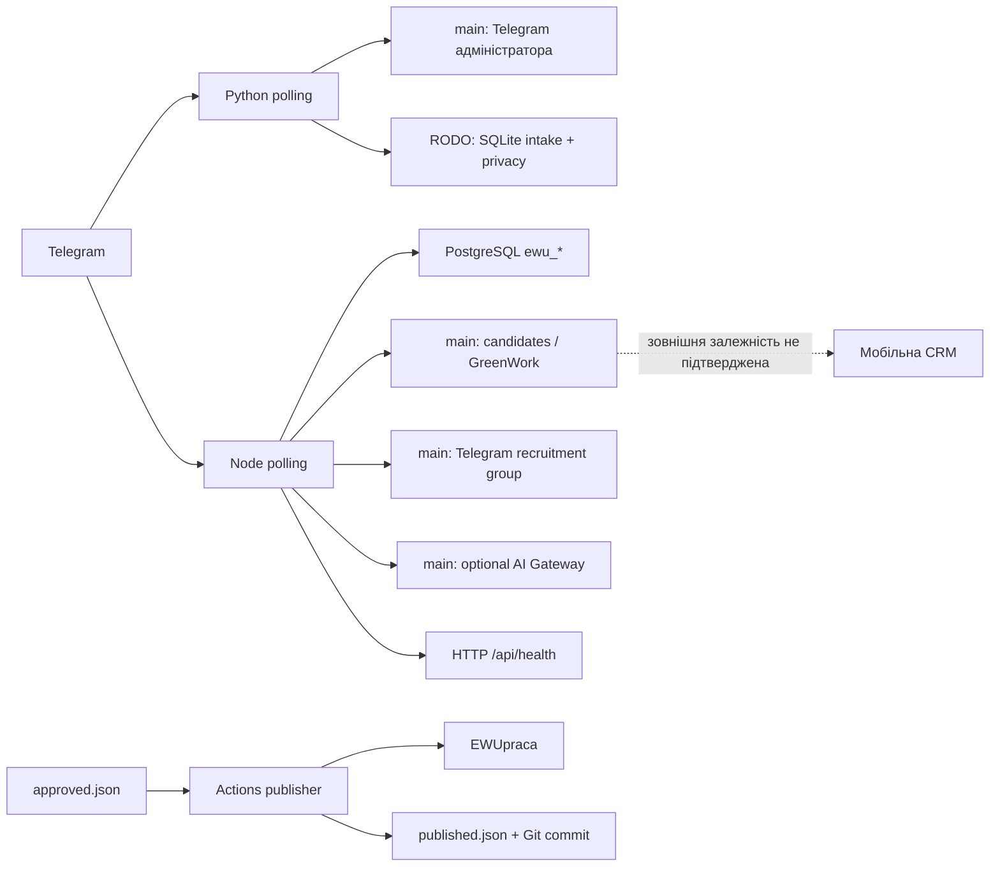

# EWU — технічний аудит перед реалізацією v2.0

Дата перевірки: 2026-10-28, Europe/Warsaw.
Репозиторій: Alex-android-code/european-workers-union-bot.

## 1. Обсяг і обмеження доказів

Повну специфікацію v2.0 (розділи 1–24) отримано після початкового обрізаного повідомлення. Аудит розділів 1–2 виконано до розробки незалежного, вимкненого за замовчуванням ядра. Факти main/RODO нижче описують перевірені базові SHA; нові зміни та їхні обмеження наведені в EWU_IMPLEMENTATION_REPORT.md.

Read-only Git-перевірка віддалених refs підтвердила:

- main: `947a44f8bce8bdde39931c2a678f884ff5f518ab`;
- feat/rodo-onboarding: `643f4a01d5bb5f9b7019c525f7fe482647b4a52d`.

Аудит порівнює код цих двох версій, конфігурацію поточної cloud-машини та результати офлайн-тестів. SHA main не є доказом SHA deployment на Railway. Відомості про запущені Railway-сервіси, active consumer Telegram, фактичну production-БД, CRM та журнали недоступні. Не можна встановити єдиний production-сервіс або наявність дублікатів лише за репозиторієм.

Не запускалися боти, webhook-команди, публікатор, live AI/Sheets/CRM-запити, міграції чи production SQL. Не читалися секрети або реальні анкети. Авторизація й інфраструктура не змінювалися.

## 2. Доступи: фактичні спостереження

| Система | Спостереження | Що не підтверджено |
|---|---|---|
| GitHub Git | Read-only ls-remote успішний; refs вище | Deployment, права API та фактична активність workflows |
| GitHub API / Actions | GET `/repos/Alex-android-code/european-workers-union-bot/actions/runs` → `Forbidden` | Runs, logs, conclusions, налаштування secrets та PR API |
| Railway | Немає connector/CLI; RAILWAY_TOKEN та RAILWAY_API_TOKEN відсутні | Проєкти, сервіси, builder/command overrides, deployments, logs, replicas, volumes, Variables |
| Telegram | TELEGRAM_TOKEN та EWU_TELEGRAM_BOT_TOKEN відсутні в cloud-процесі | Bot identity, active consumer, webhook, конфлікти polling, Operations-група |
| PostgreSQL | DATABASE_URL відсутній; production-запити не виконувалися | Реальна схема, версія, власники таблиць, споживачі, резервні копії |
| Google Sheets | GOOGLE_APPLICATION_CREDENTIALS присутня; backing file існує. Вміст не читався. OIC manifest v1 не містить connections; cloud status не повідомляє ready identity | Придатність credential, scopes, доступ до конкретної таблиці. GOOGLE_SHEETS_ID/SPREADSHEET_ID відсутні |
| GreenWork | Connector, endpoint та окремий checkout не знайдені | Живий сервіс, мобільна CRM, DB-контракти та залежності |

У cloud status немає secret bindings, runtime variable bindings або outbound identities. Це стан dev-машини, **не** стан Railway Variables. Відсутність токена в dev не означає відсутність його у production. Наявність Google credential-файлу не означає підтверджений доступ до Sheets; його не потрібно замінювати або дублювати без діагностики.

Точна помилка доступу Actions API:

```text
Get "https://api.github.com/repos/Alex-android-code/european-workers-union-bot/actions/runs": Forbidden
```

## 3. Entry points і суперечливі конфігурації

| Доказ | Команда/результат |
|---|---|
| `railway.toml` | RAILPACK, `startCommand = "python bot.py"`, ALWAYS restart |
| `Procfile` | `worker: python bot.py` |
| `Dockerfile` | `node:20-alpine`, CMD `node bot.js` |
| `package.json` | npm start → node bot.js; engines >=20 |
| `requirements.txt` | pyTelegramBotAPI==4.29.1 |
| `railway.json` | Відсутній у main і RODO-гілці |

Якщо Railway застосовує railway.toml без іншого вибору конфігурації, очікується Python. Якщо застосовується Dockerfile/override, можливий Node. Docker-образ не готує Python runtime; Python start command у цьому образі є несумісною комбінацією. Пріоритет фактично обраного builder/command треба читати з Railway, не виводити із назви файла.

Історія містить `e158407` (Node production Docker build) і `7f65d0e` (GreenWork sync). Це докази наміру/коду, не запуску. Попередній висновок «Railway використовує Python» уточнено: підтверджено лише репозиторну команду.

Для верифікації production потрібні service/environment ID, deployment SHA, ефективні builder/start command, root directory, replicas, volumes і startup logs. Без цього безпечний висновок: **production runtime невідомий**.

## 4. Карта компонентів і потоки



Стрілки позначають реалізовані шляхи у відповідних версіях, не активні production-з'єднання. Python та Node не є двома оболонками спільного backend: їхні сховища й поведінка відрізняються.

## 5. Модулі: реалізоване проти активного

| Модуль | main | RODO-гілка | Production |
|---|---|---|---|
| Python polling | Так | Так | Невідомо |
| Node polling + PostgreSQL | Так | Так | Невідомо |
| Кандидат/роботодавець/легалізація | Python: прості відповіді; Node: багатокрокові анкети | Python: мінімальні SQLite-форми; Node: мінімізовані PostgreSQL-форми | Невідомо |
| Privacy gate та історія дій | Немає | Обидва runtime, версія/час/user/action/текст | Не підтверджено deployment |
| Python admin forwarding | За ADMIN_TELEGRAM_ID | Прибрано | Невідомо |
| GreenWork candidates INSERT | Node | Прибрано | Невідомо |
| Recruitment group forwarding | Node за налаштуванням БД | Прибрано | Невідомо |
| AI / scoring | Node: AI за key/model; fallback scoring без AI | Вимкнено/прибрано | Невідомо |
| Повні транскрипти | Node ewu_messages | Нові записи прибрано | Історичні копії невідомі |
| Google Sheets CRM | Не знайдено | Не знайдено | Зовнішню реалізацію не виключено |
| Автосинхронізація вакансій GreenWork | Не реалізована | Не реалізована | Невідомо поза checkout |
| Publisher approved vacancies | Окремий Actions workflow | Збережено | Runs/secrets недоступні |

## 6. GreenWork, PostgreSQL і мобільна CRM

У main `bot.js` виконує INSERT у `candidates` з полями id, full_name, phone, citizenship, city, source, status, notes, telegram_chat. Використовується той самий Pool/DATABASE_URL, що й для ewu_sessions, ewu_applications, ewu_messages, ewu_settings. Немає окремого GreenWork HTTP API чи окремої connection configuration.

Таблиця candidates не створюється ботом; вона має існувати у сумісній зовнішній схемі. Помилка INSERT перехоплюється, а запис ewu_applications уже може бути успішним. Не виявлено outbox, retry worker або спільної транзакції між записом заявки й GreenWork. Результат «збережено» не є гарантією доставки до CRM. Випадкові UUID самі по собі не забезпечують дедуплікацію повторної бізнес-події.

Node HTTP надає лише `/api/health`; routes CRM CRUD відсутні. Мобільний застосунок може використовувати інший backend, який читає candidates, але цей backend і Android/iOS-код відсутні у checkout. Неможливо підтвердити або відкинути таку залежність. Python прямої GreenWork-інтеграції не має.

RODO-гілка вимикає GreenWork sync і групові повідомлення. Її злиття без контрактного аудиту може перервати надходження заявок до мобільної CRM. SQLite-анкети Python не синхронізуються з PostgreSQL автоматично. Тому обидві реалізації слід зберігати до підтвердження живих залежностей.

## 7. Telegram, Operations і вакансії

Обидва боти реалізують long polling. Node і main Python містять видалення webhook при запуску; RODO Python більше цього не робить. Два одночасні consumers з одним токеном можуть конфліктувати. Активний consumer, webhook і число процесів не перевірено без Railway/Telegram-доступу; жодна команда getUpdates/deleteWebhook не запускалася.

У main Operations-подібний механізм — recruitment_group_chat_id у ewu_settings. Команда bindgroup не містить перевірки повноважень адміністратора. Це не підтвердження того, що група налаштована або є саме запитаною Operations-групою.

Вакансії беруться з vacancies/approved.json, а не з Sheets/GreenWork API. Publisher має approved/verified/expiry перевірки, ledger attempted/published і at-most-once підхід. Це зменшує автоматичні дублікати, але потребує ручного розбору невизначеної доставки. Workflow має cron 07:20/12:20/17:20 UTC, manual і вибрані main push triggers. Він не запускає polling.

Publisher може commit/push ledger у main. Якщо Railway auto-deploy реагує на ці коміти без watch-path фільтра, можливі зайві deployment/restart; конфігурація невідома. Фактичні пости та історію delivery не перевіряли за реальними даними.

## 8. RODO, дані й журнали

main Node зберігає inbound текст до /start, анкети й outbound повідомлення; main Python пересилає довільний текст адміністратору. Відсутній показ інформаційного повідомлення перед intake. Вбудованого сховища документів/завантаження файлів не знайдено; наявність документів у зовнішніх Telegram/CRM/backup-системах невідома.

RODO-гілка додає чотиримовний notice, acknowledgement окремо від consent, fail-closed конфігурацію, повторний показ за зміною змісту, withdrawal і durable deletion requests. Необов'язкову AI/forwarding-обробку вимкнено. Юридичні реквізити й підстави не заповнено: policy.example.json навмисно не проходить валідацію. Pending deletion request не означає виконане видалення у всіх копіях.

RODO Python створює приватний SQLite-файл, але encryption at rest, persistent Railway volume, backups і доступ операторів потребують інфраструктурного підтвердження. Node privacy-таблиці та TTL DELETE виконуються лише при runtime; на production під час аудиту не виконувалися. TTL opportunistic, не плановий: потрібна узгоджена retention job для idle deployment.

RODO-логи використовують фіксовані event names, SDK exception bodies не виводяться. У main є exception logging і raw DB transcripts; потрібна перевірка доступу й retention platform/DB logs. Production logs не отримані. Для розрізнення runtime корисні Python `European Workers Union bot polling started` і Node `EWU production bot initialized. AI=`; не слід публікувати сирі журнали з даними кандидатів/URL токенів.

## 9. Залежності, міграції, backups і monitoring

- Python: pyTelegramBotAPI 4.29.1; у dev venv requests 2.34.2, urllib3 2.8.0, certifi 2026.10.23. Повного Python lockfile та production version pin не знайдено; CI використовує Python 3.12.
- Node: >=20 у package.json; Docker node:20-alpine. Node 20 уже поза підтримкою станом на дату аудиту; потрібна підтримувана LTS і staging-перевірка сумісності.
- main не має npm lockfile, Docker робить npm install. RODO має lockfile: pg 8.23.1, ai 6.0.317, dev-only PGlite 0.3.14; Docker використовує npm ci --omit=dev. ai залишається встановленою, але невикористаною залежністю RODO runtime.
- main та RODO використовують CREATE TABLE IF NOT EXISTS при runtime. Versioned migrations, schema-version ledger, production migration approval і перевіреного rollback не знайдено.
- Скриптів pg_dump/restore, backup policy, RPO/RTO та результатів відновлення не знайдено. Це не доводить відсутності Railway-managed backups.
- Node /api/health є статичним liveness: не перевіряє DB/polling readiness. Python HTTP health endpoint не має. External alerts, uptime checks, metrics і error aggregation не підтверджені.
- Dependency vulnerability audit не виконувався; успішний тест не є оцінкою відсутності CVE.

## 10. Перевірки цього аудиту

Використано лише синтетичні дані й ізольовані транспорти/сховища:

- `PYTHONDONTWRITEBYTECODE=1 /workspace/ewu-venv/bin/python -m unittest discover -s tests -p 'test_*.py'`: 24 тести пройшли, включно з 9 наявними publisher tests.
- Базовий `npm test`: 7 transport/transaction tests і 1 PGlite SQL integration test. Поточні розширені результати винесені в EWU_TEST_RESULTS.md.
- PGlite працює у пам'яті, не читає DATABASE_URL і не замінює staging-тест на фактичній PostgreSQL-версії.
- Git refs перевірені read-only; до початку аудиту робоча директорія була чиста.
- Жодного live Telegram, Google Sheets, PostgreSQL, GreenWork, AI, deployment або backup-restore тесту не виконано.

## 11. Реєстр ризиків

| Пріоритет | Ризик | Безпечний наступний крок |
|---|---|---|
| Критичний | Невідомий active runtime, конфлікт entrypoints | Railway read-only service/deployment inventory |
| Критичний | Можливий розрив GreenWork при merge RODO | Встановити consumers candidates і затвердити delivery contract |
| Високий | Немає підтвердженого notice/правової підстави у deployment | Юридичне затвердження конфігурації й staging-валідація |
| Високий | PostgreSQL і SQLite можуть створити дві незалежні CRM | Вибір canonical store до rollout |
| Високий | Немає підтверджених backups/restore | Узгодити RPO/RTO, захищений backup і restore drill |
| Високий | Безконтрольний group binding у main | Інвентаризація налаштувань та авторизований control plane |
| Високий | Доставка GreenWork може губитися без retry | Transactional outbox, idempotent consumer, delivery monitoring |
| Середній | Два pollers/видалення webhook | Контроль одного consumer; handoff лише після окремого погодження |
| Середній | Статичний health і можливі ledger-triggered redeploy | Readiness/alerts, перевірка Railway watch paths |
| Середній | Node20 EOL і нестабільні залежності main | LTS upgrade, locks і staging compatibility tests |

## 12. План безпечної консолідації та контрольні точки

1. Повну специфікацію вже отримано; зафіксувати цільові сутності/статуси, Sheets contract, AI budget і acceptance criteria. Не підміняти невідомі вимоги припущеннями.
2. Read-only inventory Railway: service IDs, environments, deployed SHA, effective commands/builders, replicas, volumes, health/restart/watch-path settings; записати тільки назви та статуси variables. Визначити єдиний consumer чинного бота, не зупиняючи його.
3. GreenWork/mobile audit: repository/backend endpoints, DB ownership, schema/migrations, читачі й писачі candidates/ewu_*, delivery IDs і правила доступу. Не читати анкети для технічного тесту.
4. Sheets audit: використати існуючу придатну identity, якщо вона підтверджена; отримати ID та схему таблиці, перевірити мінімальні scopes на тестовій таблиці. Визначити canonical candidate ID і лише одну погоджену Sheets CRM; не створювати дубль наосліп.
5. Вибрати runtime після підтвердження живих залежностей. Node наразі має PostgreSQL/GreenWork-контракт; Python можна зробити canonical лише з перевіреним адаптером і міграцією цього контракту. Перевага Python у специфікації не виправдовує втрату існуючої інтеграції.
6. Окремий staging: синтетичні кандидати, тестовий бот/БД/таблиця, reviewed privacy config, versioned migrations, outbox/idempotency, доступи Operations. Платний AI тільки після затвердження бюджету; до цього disabled/mock adapter.
7. Захищений backup і відновлення у staging; підтвердити row counts/schema/зв'язки без експорту PII в чат. Узгодити RPO/RTO, обмеження доступу, retention backups.
8. PR із міграціями, rollback, offline/contract/staging tests і явними breaking changes. Не відновлювати optional AI/forwarding лише на підставі acknowledgement.
9. Окреме погодження production handoff: один consumer, reconciled offsets/стан, контроль доставки CRM/Sheets, smoke checks, метрики та критерії rollback. До цього не зупиняти або видаляти старі компоненти.
10. Після погодженого стабільного періоду — окремий PR на видалення дубля й уніфікацію конфігурацій. Видалення сервісів/БД/даних потребує окремої згоди власника.

Rollback має передбачати повернення попереднього артефакту, сумісні additive migrations, replay/reconciliation outbox і недопущення другого poller. Не покладатися на reset усієї production-БД або повернення до коду без privacy gate як універсальне відновлення.

## 13. Зміни саме цього етапу

Аудит почато в окремій гілці на базі RODO-коміту; після отримання повного ТЗ гілку перейменовано на `feat/ewu-v2-foundation` і додано вимкнене за замовчуванням ядро, адаптери, міграції, тести й документацію. Перелік — у EWU_IMPLEMENTATION_REPORT.md. Railway, реальні Google Sheets/Telegram, production-БД і main не змінювалися. Production readiness та завершення всієї v2.0 не підтверджені. PR API заблокований.
